<div align="center">



# prowlscanner

**Authorized web vulnerability hunter — every finding mapped to the Vulnerability Rating Taxonomy and scored P1–P4, with evidence and a submission-ready writeup.**

[](https://github.com/ProwlSec/prowlscanner/actions)
[](https://www.python.org)
[](LICENSE)
[](#install)

</div>

---

## What it is

You give it a target — a domain, a `*.wildcard`, a URL, an IP, or a CIDR. It resolves the target live (DNS → IP → reverse DNS → live web service), maps the attack surface, crawls in scope, runs a set of **verification-based** checks, and reports only the findings that matter — each one mapped to a real **VRT** entry and filtered to **P1–P4**.

Every finding carries **evidence**, a **confidence** level, and a **submission-ready writeup**. Priorities are read **live** from the bundled VRT file — nothing is hardcoded.

```
$ prowlscanner
Target to hunt (domain, *.wildcard, URL, IP, or CIDR): testphp.vulnweb.com

[RECON]
  ⟡ resolved testphp.vulnweb.com -> 44.228.249.3
  ⟡ live web service at http://testphp.vulnweb.com/
[CRAWL]
  → 200 http://testphp.vulnweb.com/
  → 200 http://testphp.vulnweb.com/listproducts.php?cat=1
[SCAN]
  ✗ [P1] SQL injection (MySQL) via parameter 'cat' — http://testphp.vulnweb.com/listproducts.php?cat=1'
  ✗ [P3] Reflected XSS via parameter 'searchFor' — http://testphp.vulnweb.com/search.php
[REPORT]
  findings: 2  (P1:1 P3:1)
```

## What it is — and isn't

It is an honest, modular scanner that does a few classes of bug **well**, with low false positives because every check requires a confirmation signal. It is **not** a magic box that finds "every bug" with "zero false positives" — no scanner does, and any that claims to is lying. prowlscanner tells you its confidence and shows you the evidence so **you** make the call before you report.

## Install

Cross-platform — Windows, macOS, Linux (Ubuntu/Debian and friends). Pure Python, one dependency.

```bash
pip install prowlscanner            # from PyPI (once published)
pipx install prowlscanner           # isolated, recommended

# from source
git clone https://github.com/ProwlSec/prowlscanner
cd prowlscanner
pip install -e ".[dev]"
```

## Usage

```bash
# interactive — asks for the target, then hunts
prowlscanner

# direct
prowlscanner example.com
prowlscanner "*.example.com" --authorize
prowlscanner https://app.example.com/ --html report.html --submissions bugs.txt

# scope file (in-scope / out-of-scope / not-applicable)
prowlscanner --scope-file examples/scope.example.json --authorize

# web console (live feed, surface, graph, findings, connectors)
prowlscanner serve

# seed targets from your existing tools
prowlscanner --import proxy-history.xml --authorize      # Burp / Caido export
prowlscanner --import collection.json --authorize        # Postman collection

# MCP server — drive scans from Claude or any MCP client
prowlscanner mcp
```

Key flags: `--out-of-scope`, `--not-applicable <vrt-id>`, `--bands 1,2,3`, `--depth`, `--max-urls`, `--rate`, `--insecure`, `--json/--html/--sarif/--submissions`.

### Authorization

prowlscanner sends **live, active probes**. It will not scan until you confirm authorization — interactively (type `yes`) or with `--authorize`. Only test systems you own or are explicitly permitted to assess.

## Scope model

```jsonc
{
  "in_scope":        ["*.example.com", "example.com"],
  "out_of_scope":    ["blog.example.com"],
  "not_applicable":  ["server_security_misconfiguration/mail_server_misconfiguration"],
  "bands":           [1, 2, 3, 4]
}
```

In-scope accepts domains, wildcards, URLs, IPs and CIDRs. Anything matching `out_of_scope` is never touched. `not_applicable` VRT ids/prefixes are skipped entirely — those modules don't even run.

## Checks

Every check maps to a VRT variant; the priority column is read from the bundled taxonomy at runtime.

| Module | Detects | VRT | Priority |
| --- | --- | --- | --- |
| `sqli-error` | Error-based SQL injection | `server_side_injection/sql_injection` | P1 |
| `sqli-blind` | Blind / time-based SQL injection (differential timing, double-confirmed) | `server_side_injection/sql_injection` | P1 |
| `xxe` | XML external entity injection (file disclosure) | `server_side_injection/xml_external_entity_injection_xxe` | P1 |
| `path-traversal` | Local file inclusion / traversal | `server_side_injection/file_inclusion/local` | P1 |
| `sensitive-exposure` | Exposed `.git` / `.env` / backups with secrets | `sensitive_data_exposure/disclosure_of_secrets/...` | P1 |
| `secrets` | Secrets in delivered JS/HTML | `sensitive_data_exposure/disclosure_of_secrets/...` | P1 |
| `ssrf` | Server-side request forgery (internal data exposure) | `server_security_misconfiguration/server_side_request_forgery_ssrf/internal_data_exposure` | P3 |
| `admin-portal` | Exposed admin interface (WordPress, phpMyAdmin, Jenkins, …) | `server_security_misconfiguration/exposed_portal/admin_portal` | P1 |
| `jwt` | JWT `alg:none` · weak/guessable HMAC secret (cracked offline) | `broken_authentication_and_session_management/authentication_bypass` | P1 |
| `reflected-xss` | Reflected XSS (non-self) | `cross_site_scripting_xss/reflected/non_self` | P3 |
| `open-redirect` | GET-based open redirect | `unvalidated_redirects_and_forwards/open_redirect/get_based` | P4 |
| `subdomain-takeover` | Dangling DNS → unclaimed service fingerprint | `server_security_misconfiguration/misconfigured_dns/subdomain_takeover` | P3 |
| `verbose-error` | Stack trace / server-config disclosure | `sensitive_data_exposure/visible_detailed_error_page/detailed_server_configuration` | P4 |
| `transport-security` | Login over HTTP · token in URL | `broken_authentication.../over_http` · `sensitive_data_exposure/sensitive_token_in_url/...` | P4 |
| `cookie-flags` | Session cookie missing HttpOnly/Secure | `server_security_misconfiguration/missing_secure_or_httponly_cookie_flag/session_token` | P4 |
| `clickjacking` | Framable sensitive-action page | `server_security_misconfiguration/clickjacking/sensitive_action` | P4 |

P5 / "varies" conditions (self-XSS, internal-IP disclosure, generic missing headers, …) are **suppressed** by default — that is the whole point of the VRT filter.

## Connectors

prowlscanner plugs into the tools you already use — from the **Connectors** tab in `serve`, or the CLI.

- **Claude / any MCP client (AI-assisted pentesting).** prowlscanner ships an MCP server (`prowlscanner mcp`, stdio) exposing `prowl_scan`, `prowl_vrt` and `prowl_modules`, so Claude (Desktop or Code), Cursor, Cline or any MCP-capable model can run authorized scans and reason over the findings.
  ```bash
  # Claude Code
  claude mcp add prowlscanner -- prowlscanner mcp
  ```
  ```jsonc
  // Claude Desktop / other MCP clients
  { "mcpServers": { "prowlscanner": { "command": "prowlscanner", "args": ["mcp"] } } }
  ```
  Scans still require explicit authorization — the assistant must pass `authorize: true`.
- **Postman.** Import a collection to seed the scan with its request URLs (`--import collection.json`, or the Connectors tab).
- **Burp Suite / Caido.** Import a proxy-history export to seed targets (`--import history.xml`). Pick whichever proxy you use.

Because the engine speaks MCP, any other MCP-based tooling can be wired in the same way.

## Reports

- **`--json`** — full machine-readable report: overview, attack surface, attack graph, findings.
- **`--html`** — styled standalone report.
- **`--sarif`** — drops into GitHub code scanning.
- **`--submissions`** — one writeup per finding in the program-submission template:

```
Target Location
app.example.com
Target category
Web App
VRT
Server Side Injection > SQL Injection
Bug URL
https://app.example.com/listproducts.php?cat=1'
Description
...
Business Impact
...
Steps to Reproduce
...
Proof of Concept (PoC)
GET /listproducts.php?cat=1' HTTP/1.1 ...
```

The JSON report also contains the **attack surface** (resolved hosts, live services, endpoints, parameters, server banners) and an **attack graph** (`scope → host → ip → service → endpoint → finding` as nodes/edges) that the web console renders.

## Roadmap

Same verification-first module pattern, next up: SSRF with an out-of-band collaborator (for blind cases), authenticated stored XSS, IDOR with supplied session context, and CORS once a suitable taxonomy entry applies. Contributions welcome — a module is one file implementing one `Module`.

## Releasing

Publishing to PyPI is automated. Configure a [trusted publisher](https://docs.pypi.org/trusted-publishers/) on PyPI once (project `prowlscanner`, owner `ProwlSec`, workflow `publish.yml`, environment `pypi`), then cut a GitHub Release — the `publish` workflow builds and uploads the wheel. No API tokens to manage.

## Credits & license

prowlscanner is MIT-licensed. Severity priorities are derived from the open Vulnerability Rating Taxonomy (VRT) dataset bundled in `src/prowlscanner/data/`, distributed under the Apache-2.0 license (see `src/prowlscanner/data/VRT-LICENSE.md`).

> Use only against systems you are authorized to test. You are responsible for your use of this tool.
